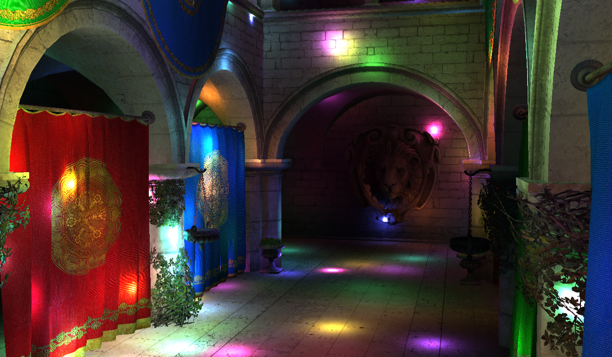
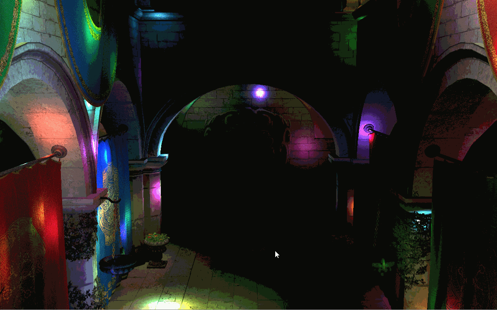
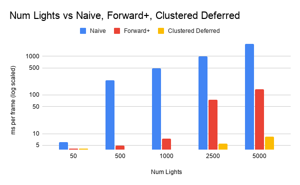
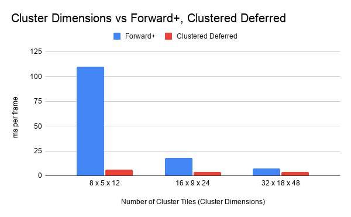

WebGL Forward+ and Clustered Deferred Shading
======================

**University of Pennsylvania, CIS 565: GPU Programming and Architecture, Project 4**

* Alice Liu
  * [LinkedIn](https://www.linkedin.com/in/aliceliuu/), [personal website](https://aliceliu.xyz/)
* Tested on: **Google Chrome 155.0.8059.85** on
  Windows 11, AMD Ryzen 5 7640HS @ 4.30GHz 16GB, RTX 4060 Laptop GPU 8GB (Personal Laptop)

### Live Demo

  Click on the image or gif above to go to live demo site!

## Overview

In this project, I implemented WebGPU based naive forward, forward+, and clustered deferred rendering using typescript and WGSL. Each implementation is described more in detail below! 

### Naive Forward
In the Naive Forward implementation, everything is rendered in one pass. For each fragment in the scene, we must iterate through every single light in the scene. 

### Forward+
In the Forward+ implementation, everything is still rendered in one pass, but we partition the camera's view frustum into clusters. We then assign lights to clusters if the light intersects with the cluster's bounding box. For each fragment in the scene, we now only need to iterate through the lights in its corresponding cluster, instead of through every light in the scene. 

### Clustered Deferred
In the Cluster Deferred implementation, we render with two passes (deferred shading). In the first G-buffer pass, we store the albedo, normal, and depth into textures. Then, we do a fullscreen pass where we read from the textures and shade using the same lighting clustering optimization from Forward+. In this deferred implementation, we only compute lighting for the visible pixels insteads of all fragments (possible pixels). 

## Performance Analysis

### Number of Lights

   

From this graph, we can see that between Naive, Forward+, and Clustered Deferred shading, overall Naive is the slowest, Forward+ is in the middle, and Clustered Deferred is the fastest. Clustered Deferred seems to scale well under scenes with many lights. At 5000 lights, it is clearly a much better choice than the others. Forward+ is consistently better than Naive, but in scenes with many lights, it does not scale as well as Clustered Deferred. Since Naive has linear time complexity with lights, it is not suitale for scenes with many lights, but is not a bad choice when the number of lights is small. 

The benefits of using Clustered Deferred is its fast runtime, especially in scenes with many lights due to the deferred rendering. It only calculates light for visible pixels, unlike Forward+, which calculates light for every fragment. However, because of this, Clustered Deferred uses more memory because it needs to store the albedo, normal, and depth textures. 

This was tested in a scene dividing the frustum into 32 x 18 x 48 clusters and the result of the average of 100 frames. 

### Number of Cluster Tiles

   

From this graph, we can see that dividing the camera frustum into 32 x 18 x 48 clusters (27,648 total clusters) resulted in the fastest runtime. This is because dividing it into more clusters causes the cluster volumes to be smaller and intersect with less lights on average. As the number of total clusters decreases, it begins to approach the Naive method where you need to check a fragment with every light in the scene.

While not demonstrated in the graph, there is a tradeoff to a larger number of total clusters, as it increases the total compute workgroup dispatch count and the overhead of calculating the bounding boxes and light intersections can become expensive.

This was tested in a scene with 1000 lights and the result of the average of 500 frames. 

### Max Lights Per Cluster

   
  Artifacts when maxLightsPerCluster is too small (128) in a scene with 3000 lights

Having the max lights per cluster be too small caused rendering artifacts when the number of lights was large. Increasing the max lights per cluster variable fixed it at the cost of memory. In the current implementation, maxLightsPerCluster is 512. 

## Credits

- [Concepts](https://www.aortiz.me/2018/12/21/CG.html)
- [Vite](https://vitejs.dev/)
- [loaders.gl](https://loaders.gl/)
- [dat.GUI](https://github.com/dataarts/dat.gui)
- [stats.js](https://github.com/mrdoob/stats.js)
- [wgpu-matrix](https://github.com/greggman/wgpu-matrix)
